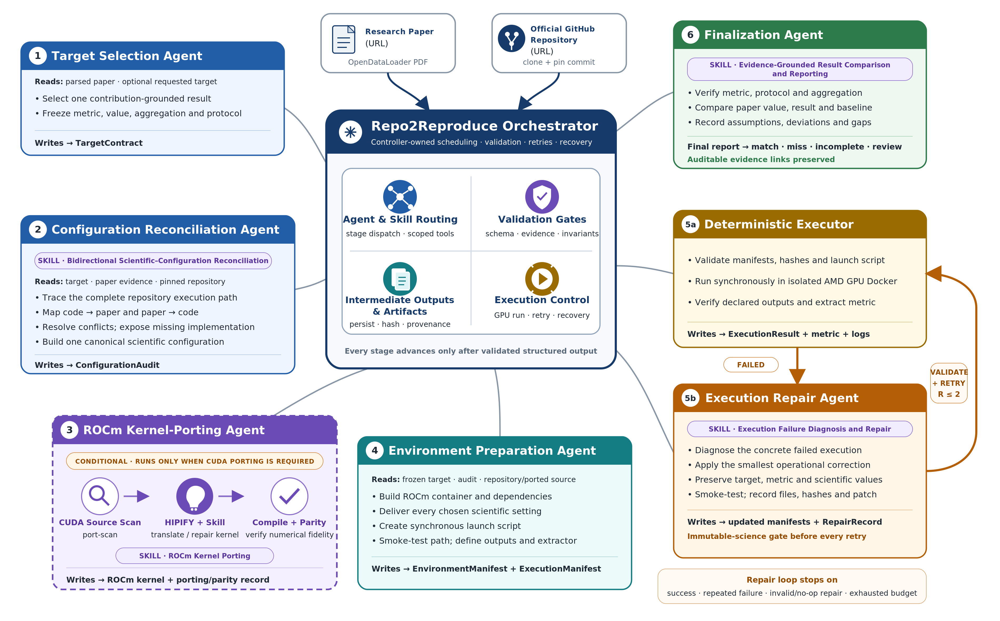

# Repo2Reproduce

Repo2Reproduce is a multistep agent based on Claude-code SDK that reproduces a paper's result from its official repository: it selects a target, reconciles paper and code settings, builds a Docker environment, runs the experiment deterministically, and compares the metric with the paper. It runs on AMD Instinct GPUs and ROCm.

[](LICENSE)



## Architecture

A run takes two inputs, a paper URL and its official repository URL. The paper is parsed
with OpenDataLoader PDF, and the repository is cloned and pinned to a commit.

### Orchestrator

The **Repo2Reproduce Orchestrator** is ordinary Python code, not an agent. 

### Stages

1. **Target Selection Agent.** Reads the parsed paper and an optional `--target`. Picks
   one result grounded in the paper's contribution and freezes its metric, value,
   aggregation, and protocol. Writes `target.json`.
2. **Configuration Reconciliation Agent.** Uses the *bidirectional scientific-configuration
   reconciliation* skill. Traces the repository's execution path, maps code to paper and
   paper to code, resolves conflicts, and flags anything the code does not implement. The
   result is one canonical scientific configuration in `configuration_audit.json`.
3. **ROCm Kernel-Porting Agent** (only with `--porting rocm` or `force`; it runs as part of
   environment preparation). Scans the CUDA
   sources, translates them with the official HIPIFY plus the *ROCm kernel porting* skill,
   compiles them, and checks numerical parity with a reference. Writes the ported kernels
   and a porting record. See [PORTING.md](PORTING.md).
4. **Environment Preparation Agent.** Builds a ROCm Docker image with the dependencies,
   applies every chosen scientific setting, writes a synchronous launch script, and runs
   a short smoke test. Writes `environment_manifest.json` and `execution_manifest.json`.
5. **Execution.**
   - **5a. Deterministic Executor.** Plain Python, no agent. Checks the manifest, hashes,
     and launch script, runs the experiment in an isolated GPU container, checks the
     declared outputs, and extracts the metric. Writes `execution_result.json` and logs.
   - **5b. Execution Repair Agent.** Runs only if execution failed. Uses the *execution
     failure diagnosis and repair* skill to apply the smallest operational fix, smoke-test
     it, and record the patch. Target, metric, and scientific values are frozen and checked
     before every retry. The loop runs at most two repairs and stops on success, a
     repeated failure, an invalid or no-op repair, or an exhausted budget.
6. **Finalization Agent.** Uses the *evidence-grounded result comparison* skill. Checks
   the metric, protocol, and aggregation, compares the paper value, the reproduced value,
   and the paper's baseline, and records assumptions, deviations, and gaps. Writes
   `final_report.md` with a verdict of `match`, `miss`, `run_incomplete`, or
   `needs_review`, and links to the evidence.


## Requirements

- Linux with AMD Instinct GPUs and the ROCm kernel driver (`rocm-smi` lists the GPUs)
- Docker, usable without `sudo`
- Python 3.10–3.13, Git, curl, Perl, and Java 11+
- The Claude Code CLI (`setup.sh --install-claude` installs it)
- Access to Claude, through the Anthropic API or an Anthropic-compatible gateway
- Tens of GB of disk per paper, for repositories, caches, and outputs

[USER_GUIDE.md](USER_GUIDE.md#1-set-up-the-environment) has the install commands.

## Installation

```bash
git clone <repo-url> Repo2Reproduce
cd Repo2Reproduce
scripts/setup.sh --install-claude --with-tests
```

`setup.sh` checks the host, creates `.venv`, installs the package, creates `.env` from
`.env.example`, and runs the unit tests. It prints how to fix anything missing.

## Configuration

Settings are read from `.env` in the checkout. [`.env.example`](.env.example) lists every
setting with comments; copy it and fill in your values:

```bash
cp .env.example .env
```

## Run one paper

Select a paper from the [dataset](dataset/README.md) by id or name. The dataset supplies
the paper and repository; without `--target`, the agent picks the result.

```bash
scripts/list_papers.sh                                # ids, names, and paper links
scripts/run_one.sh 9 --gpu 0                          # by id
scripts/run_one.sh convolutional-diffusion --gpu 0    # the same paper, by name
scripts/run_one.sh nsnquant --gpu 1 --detach          # in the background
```

Any paper with public code works too:

```bash
scripts/run_one.sh --paper https://arxiv.org/abs/<id> --repo https://github.com/<org>/<repo> --gpu 0
```

| Flag | Description |
| --- | --- |
| `--gpu N` | Physical AMD GPU index from `rocm-smi` (default `0`). |
| `--target TEXT` | Result to reproduce (default: the agent chooses). |
| `--porting MODE` | `none` (default), `rocm`, or `force`. |
| `--max-budget-usd USD` | Spending cap for the whole run; overrides `R2R_MAX_BUDGET_USD`. |
| `--prepare-only` | Build and freeze the run without executing it. |
| `--detach` | Run in the background; the log is `<runs-root>/<run-id>.log`. |

## Run all papers

`run_all.sh` runs the papers one after another on one GPU. A failed paper does not stop the
batch.

```bash
scripts/run_all.sh --gpu 0 --detach                   # all 22 papers
scripts/run_all.sh --gpu 0 --only 5,9,nsnquant        # a subset
scripts/run_all.sh --gpu 0 --skip 10,refersplat       # all but these
```

To use two GPUs, start one batch per GPU on different papers:

```bash
scripts/run_all.sh --gpu 0 --only 1,2,3,4,5,6,7,8,9,10,11 --detach
scripts/run_all.sh --gpu 1 --only 12,13,14,15,16,17,18,19,20,21,22 --detach
```

| Flag | Description |
| --- | --- |
| `--gpu N` | GPU for every run (default `0`). |
| `--only LIST`, `--skip LIST` | Comma-separated ids or names to run, or to leave out. |
| `--max-budget-usd USD` | Spending cap for each paper's run. |
| `--stop-on-error` | Stop at the first paper that does not succeed. |
| `--detach` | Run the batch in the background. |

## Choose a target

`--target` names the result to reproduce. Name a table, row, or figure; leave out
hyperparameters, because the configuration audit finds them in the paper and code.

```bash
scripts/run_one.sh cogs --gpu 0 --target "Reproduce Table 2, the d=71 modular-addition row."
```

## Port CUDA kernels to ROCm

Some papers ship their contribution as a CUDA kernel. `--porting` controls how strictly
that code must be ported to ROCm:

| Mode | Behavior |
| --- | --- |
| `none` | No porting policy. |
| `rocm` | Port CUDA code with the official HIPIFY and check numerical parity. |
| `force` | The paper's own CUDA kernel must run on ROCm, through HIPIFY with fixes or a rewrite. |

```bash
scripts/run_one.sh sageattention --gpu 0 --porting force
```

See [PORTING.md](PORTING.md) for how porting works and what it achieved.

## Set a budget

`R2R_MAX_BUDGET_USD` in `.env`, or `--max-budget-usd` on the command line, caps the agent
cost of a whole run: target selection, audit, preparation, repairs, the final report, and
any recovery together. Each agent session gets only what the run has left, and the run
stops with status `failed` once the budget is spent. `budget.json` in the run directory
records the cost of each session.

```bash
scripts/run_one.sh cogs --gpu 0 --max-budget-usd 30
scripts/run_one.sh --recover "$R2R_RUNS_ROOT/<run-id>" --gpu 0 --max-budget-usd 45
```

When recovering, the budget is the new total for the run, including what it already spent.

## Read the results

The main result of a run is **`final_report.md`** in its run directory. The Finalization
Agent writes it with the **`paper-result-comparison` skill**
([`repo2reproduce/skills/paper-result-comparison/`](repo2reproduce/skills/paper-result-comparison/SKILL.md)),
which compares the reproduced value with the paper only from saved evidence.

To compare many runs at once, `scripts/summarize.sh` prints one line per run with its
status, verdict, paper value, and reproduced value (`--tsv` for a spreadsheet). See
[USER_GUIDE.md](USER_GUIDE.md#4-interpret-the-results) for what each status and verdict
means.

## Third-party content and service terms

Repo2Reproduce can send prompts, paper excerpts, source-code excerpts, and tool output to
the configured language-model provider. Do not use confidential, restricted, or
third-party material unless you are authorized to submit it to that provider.

The research repositories, papers, datasets, checkpoints, container images, and other
assets processed by a run keep their original licenses and terms. Generated ports and
run artifacts do not relicense their source material. Review those terms before using or
redistributing generated Docker images, ported repositories, or other artifacts.

## License

- Code authored by Advanced Micro Devices, Inc. is licensed under
  [Apache-2.0](LICENSE).
- Included or adapted third-party code retains its original license.
- Claude Agent SDK, Claude Code CLI, Anthropic services, HIPIFY, downloaded research
  repositories, papers, datasets, and checkpoints are governed by their respective
  licenses and terms.
- See [NOTICE](NOTICE) and
  [THIRD_PARTY_NOTICES.md](THIRD_PARTY_NOTICES.md) for details.
